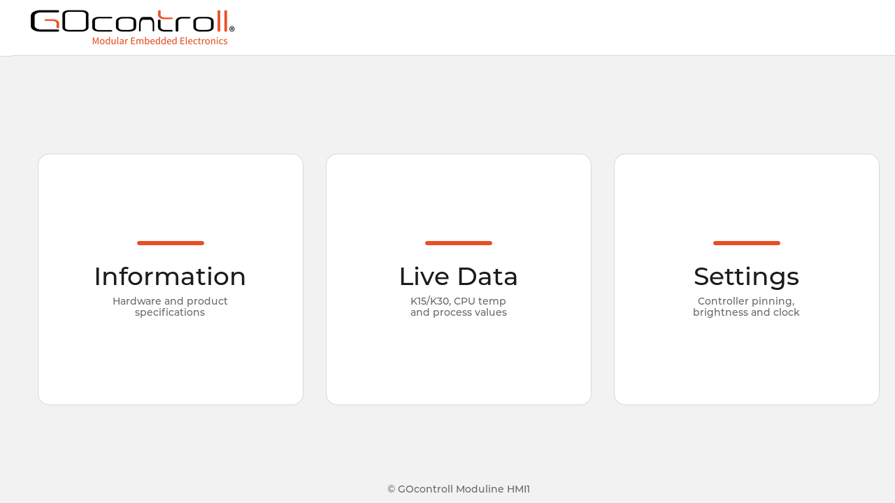

# GOcontroll-HMI-Demo

A minimal HMI demo for the GOcontroll **Moduline HMI1**, built on
[LVGL](https://lvgl.io) (MIT) and rendering directly to KMS/DRM — no Wayland or
X11 compositor required.



*The main screen: branded header bar with clock, and three tiles that open the
Information, Live Data and Settings screens.*

The demo is meant as a starting point: it shows a complete, touch-driven
dashboard on the HMI1 panel and is deliberately small enough to read end to end
and to reshape into your own UI.

## What it shows

| Screen | Contents |
|---|---|
| **Main** | GOcontroll header + clock, three navigation tiles, footer |
| **Information** | Left: network (IP/MAC), system (demo version, distro, kernel, serial), hardware (model/board) and detected module slots. Right: Moduline HMI1 product specifications |
| **Live Data** | K15 and K30 voltage arc gauges, rolling CPU-temperature chart, and four process values (temperature, pressure, SOC, power) |
| **Settings** | Connector-A pin table, rear-view photo of the HMI1, display-brightness slider, "show clock" toggle and an "Exit demo" button |

## Hardware and rendering stack


The demo targets the Moduline HMI1: an NXP i.MX 8M Plus (4x Cortex-A53, Vivante
GC7000) driving a 1280x720 LVDS panel that is physically mounted upside down.

* `src/drm_display.c` owns two dumb DRM scanout buffers and ping-pongs
  page-flips between them. LVGL renders into a cached shadow buffer; presenting
  rotates that shadow 180° into the back buffer in one write-only pass.
* Touch comes from the `cyttsp6_mt` evdev node, calibrated in `src/main.c` with
  both axes inverted so the touch frame matches the rotated scanout.
* LVGL uses its software renderer with NEON SIMD (`LV_USE_DRAW_SW_ASM`), single
  draw unit, single-threaded event loop, 32-bit XRGB8888 colour depth. See
  `lv_conf.h`.
* An optional GLES 2.0/EGL/GBM compositing path is available behind the CMake
  option `-DUSE_OPENGLES=ON`.

A separate, LVGL-free boot splash (`splash/`) holds a zooming GOcontroll logo on
the panel from `sysinit.target` onwards and fades to black on SIGTERM; the main
binary then fades the dashboard in from black, so the handoff has no hard cut.

## Repository layout

```
src/
  main.c              entry point, LVGL init, display/touch setup, main loop
  drm_display.c/.h    KMS/DRM wrapper, double buffering, 180° rotate-on-present
  ui.c/.h             all screens, tiles, widgets, styling and refresh timers
  ipc.c/.h            process_vm_readv/writev wrappers (Simulink IPC)
  config.c/.h         signals.json / parameters.json loader + fallback addresses
  settings.c/.h       persisted preferences (/var/lib/gocontroll-hmi-demo)
  shm_data.c/.h       /dev/shm process values (TEMPERATURE/PRESSURE/SOC/POWER)
  sysinfo.c/.h        IPv4, MAC and CPU temperature from /sys
  identify.c/.h       OS, kernel, serial, devicetree model, module slots
  product_info.c/.h   static Moduline HMI1 specification tables
  controller_pins.c/.h  connector-A system pin table (K15/K30/K31, CAN)
  module_pins.c/.h    per-module pin tables for the MDS1/MDS2 slots (generated)
  fonts/              Montserrat 14 regenerated with U+00A9
splash/               standalone boot-splash binary (DRM + libpng, no LVGL)
scripts/
  gen_module_pins.py  regenerates src/module_pins.{c,h}
  gocontroll-hmi-demo-nodered-flow  merges the Node-RED tab below into an
                      existing Node-RED installation
nodered/
  hmi1-demo-flow.json Node-RED tab that drives the /dev/shm process values
assets/               logos and HMI1 product images
debian/               packaging: control, rules, postinst, systemd units
lv_conf.h             LVGL build configuration
thirdparty/lvgl       LVGL v9 as a git submodule
```

## Building from source

Native build on the device:

```sh
git clone --recurse-submodules https://github.com/GOcontroll/GOcontroll-HMI-Demo.git
cd GOcontroll-HMI-Demo
apt install -y cmake pkg-config libdrm-dev libgbm-dev libegl-dev libgles-dev \
    libevdev-dev libcjson-dev libpng-dev libfreetype-dev build-essential
cmake -S . -B build -DCMAKE_BUILD_TYPE=Release
cmake --build build -j$(nproc)
./build/gocontroll-hmi-demo            # run from a non-graphical TTY
```

This produces two binaries: `build/gocontroll-hmi-demo` (the dashboard) and
`build/splash/gocontroll-hmi-splash` (the boot splash).

CMake options:

* `-DUSE_OPENGLES=ON` — route LVGL's output through OpenGL ES 2.0 via EGL+GBM
  on the GC7000 GPU. Adds `libgbm`/`libegl` runtime dep. Default OFF; the
  static UI is too small for the GPU upload to pay off, but the option is here
  for richer UIs.

Running the binary by hand needs DRM master on `/dev/dri/card1`, so stop the
packaged service first (`systemctl stop gocontroll-hmi-demo`) and run it
from a TTY that no compositor or splash is holding.

## Installing and running on a Moduline HMI1

### 1. Build the Debian package

```sh
apt install -y debhelper dpkg-dev
dpkg-buildpackage -us -uc -b
```

`debian/rules` installs `signals.json` and `parameters.json` from the source
root when they are present. Both are gitignored (they are generated per Simulink
build — see below), so a fresh clone does not have them; the build then skips
them and `src/config.c` falls back to addresses derived from the ELF symbols of
the bundled `gocontroll_demo`. Supply them if you want the package to ship the
exact Simulink mapping.

The result is `../gocontroll-hmi-demo_<version>_<arch>.deb`.

### 2. Install it on the device

```sh
apt install ./gocontroll-hmi-demo_*.deb
```

The package `gocontroll-hmi-demo` installs:

* `/usr/bin/gocontroll-hmi-demo` — the dashboard binary
* `/usr/bin/gocontroll-hmi-splash` — the boot splash
* `/usr/bin/gocontroll_demo` — the Simulink companion process
* `/usr/bin/gocontroll-hmi-demo-nodered-flow` — Node-RED tab installer
* `/usr/share/gocontroll-hmi-demo/` — `GOcontroll.png`, `GOcontroll_header.png`,
  `GOcontroll_splash.png`, `hmi1_3d.png`, `hmi1_back.png`, `hmi1_connectors.png`,
  `signals.json`, `parameters.json`, `nodered/hmi1-demo-flow.json`
* three systemd units in `/usr/lib/systemd/system/`:
  `gocontroll-hmi-demo.service`, `gocontroll_demo.service` and
  `gocontroll-hmi-splash.service`

`dh_installsystemd` enables all three units at install time and starts the
dashboard and the Simulink backend; the splash is only started at boot, so it
does not fight a running dashboard for DRM master.

Display and backlight recovery is the kernel's job from 1.0.5 on: the HMI1
kernel waits out a busy i2c-3 at probe time and reprograms the MAX25014 after a
power-on reset (`max25014.watchdog_ms`). The `gocontroll-hmi-display-recover`
helper of 1.0.1–1.0.4 is gone; upgrading stops it and removes its enable link.
It needs a kernel built from `GOcontroll/linux@gocontroll-6.12.87` at
`76d8f6835f3d` or later. On an older kernel, stay on 1.0.4. The splash and the
dashboard both wait up to 15 s for `/dev/dri/card1`, which can appear late
while the kernel waits for the bus.

The kernel keeps the backlight at 0 until userspace turns it on. The splash
fades it in from its first frame, on a 1.2 s perceptual ramp, to 50% (or
`GOCONTROLL_SPLASH_BRIGHTNESS` in percent).
If `systemd-backlight` restores a saved value first, the splash leaves it as is.

### 3. Control the services

```sh
systemctl status  gocontroll-hmi-demo     # is the dashboard up?
systemctl restart gocontroll-hmi-demo     # reload after an upgrade
systemctl stop    gocontroll-hmi-demo     # release the panel
systemctl enable  gocontroll-hmi-demo     # start on every boot
journalctl -u gocontroll-hmi-demo -f      # follow its log
```

Notes on the unit wiring, all visible in `debian/*.service`:

* `gocontroll-hmi-demo.service` runs as root (the Simulink IPC uses
  `process_vm_readv`), takes over `/dev/tty1` and therefore
  `Conflicts=getty@tty1.service`. It is `WantedBy=graphical.target`, so the
  device's default target must reach `graphical.target` for it to auto-start at
  boot; otherwise start it explicitly.
* It stops the splash synchronously via `ExecStartPre` before grabbing DRM
  master — a unit-level `Conflicts=` loses that race at boot.
* `gocontroll_demo.service` (the Simulink backend) and the splash are both
  `WantedBy=sysinit.target`, i.e. very early in boot.
* Without `gocontroll_demo` running, the demo still starts; K15/K30 simply show
  `-`. The pid is re-resolved whenever IPC fails, so a backend that starts or
  restarts later is picked up within a couple of seconds without restarting the
  HMI.

Pressing **Exit demo** on the Settings screen makes the process exit cleanly.
Since the unit has no `Restart=`, the panel stays dark until you start the
service again.

### 4. Driving the process values from Node-RED

`nodered/hmi1-demo-flow.json` is a single Node-RED tab, **HMI1 Demo**, that
changes what the four process-value cards on the Live Data screen show. It holds
one `Write-Memory` node per value (`TEMPERATURE`, `PRESSURE`, `SOC`, `POWER`) and
two inject buttons each, so the values can be switched while presenting the
demo. `Write-Memory` with `memtype: ram` writes `/dev/shm/<KEY>` as an ASCII
float, which is exactly what `src/shm_data.c` reads — no other coupling between
the two.

The tab also carries a `Controller-Active` node that fires once on deploy and
writes `/sys/class/leds/power-active/brightness`; with the shipped payload
(`controllerActive: 0`) that switches the green power LED **off**.

`postinst` calls the installer, so a normal `apt install` brings the tab along:

```sh
gocontroll-hmi-demo-nodered-flow            # add the tab if it isn't there
gocontroll-hmi-demo-nodered-flow --check    # report, change nothing
gocontroll-hmi-demo-nodered-flow --force    # re-apply, discarding tab edits
```

Only the tab with our own id is touched: every other tab, subflow and config
node in `flows.json` is passed through unchanged, and the previous file is kept
as `flows.json.pre-gocontroll-hmi-demo` whenever something is written. The
default is `--if-absent`, so an upgrade never overwrites edits made to the tab on
the device — use `--force` for that. Node-RED only reads `flows.json` at startup,
so the installer restarts `nodered` if it was running.

Two things it cannot do for you:

* The nodes come from the GOcontroll npm package, whose scope differs per image
  (`@gocontroll-nl/node-red-gocontroll` on older ones,
  `@gocontroll/node-red-gocontroll` from 2.3 on). If it is missing the installer
  says so and the tab loads with unknown node types; fix it with
  `cd ~/.node-red && npm install @gocontroll/node-red-gocontroll`.
* It does not enable `nodered`. On an image where Node-RED is disabled,
  `systemctl enable --now nodered` exposes the editor on port 1880 — a
  deliberate decision, so the package leaves it alone.

## Customising the dashboard

Everything you see on screen is built in **`src/ui.c`** with plain LVGL calls —
there is no layout description file, no XML, no code generator. Change the C,
rebuild, restart the service.

### How `ui.c` is organised

`ui.c` reads top to bottom in five parts:

1. **Theme constants** — the brand palette (`BRAND_ORANGE`, `BRAND_DARK`,
   `BRAND_BG`, `BRAND_PANEL`, `BRAND_SUBTEXT`, `BRAND_DIVIDER`,
   `BRAND_ORANGE_SOFT`) and tunables such as `TICK_PERIOD_MS` (200 ms → 5 Hz UI
   refresh), `CHART_POINTS` (60-sample rolling window) and `GAUGE_RANGE_MV`
   (arc full-scale, 16 V). Recolouring the whole UI is a matter of editing the
   seven `#define`s.
2. **The `g` struct** — one static struct holding the four screen objects
   (`scr_main`, `scr_info`, `scr_live`, `scr_settings`) plus every widget handle
   that gets updated at runtime. Any widget you want to refresh later needs a
   field here.
3. **Reusable builders** — `style_panel()`, `style_title()`, `style_heading()`,
   `style_sub()`, `make_tile()`, `build_page_header()`, `add_kv_row()`,
   `make_info_panel()`, `build_gauge_card()`, `build_temp_chart_card()` and
   `build_shm_card()`. Use these instead of styling from scratch and new content
   matches the rest automatically.
4. **One `build_*_screen()` per screen** — see the table below.
5. **The refresh path** — `tick_cb()` runs every `TICK_PERIOD_MS` and dispatches
   to `refresh_live_screen()` or `refresh_info_screen()` depending on which
   screen is active; a counter throttles the clock label and the chart push down
   to 1 Hz.

### Which function draws what

| Screen | Function in `src/ui.c` | What it builds |
|---|---|---|
| Main | `build_main_screen()` | 80 px header bar with `GOcontroll_header.png` and the clock label, a centred flex row of three `make_tile()` buttons (380x360 each), and the footer label |
| Information | `build_info_screen()` | Page header, then a two-column body: `build_info_hardware_side()` (left) and `build_info_product_side()` (right) |
| Live Data | `build_live_screen()` | Row 1: two `build_gauge_card()` arcs (K15/K30) plus `build_temp_chart_card()`. Row 2: four `build_shm_card()` cards (temperature, pressure, SOC, power) |
| Settings | `build_settings_screen()` | Left column `build_pinning_panel()` (an `lv_table` of connector-A pins, 520 px wide), right column `build_settings_controls()` (HMI1 rear-view image, brightness slider, clock checkbox, exit button) |

The Settings screen also absorbs what used to be a separate Configuration
screen: the pin table and the controls now share one page.

All four screens are constructed once in `ui_build()` and switched with
`lv_screen_load()` from the `go_main_cb` / `go_info_cb` / `go_live_cb` /
`go_settings_cb` callbacks. Screens are never rebuilt, so anything dynamic must
be updated through a handle stored in `g`.

Layout sizes are written against the 1280x720 panel (`720 - 80` for the main
body, `720 - 72` below a page header). If you re-target another resolution,
these are the numbers to parameterise.

### Adding a tile and a new screen

1. Add `lv_obj_t *scr_mine;` to the `g` struct.
2. Write `build_mine_screen()`: `lv_obj_create(NULL)`, set `BRAND_BG` as the
   background, call `build_page_header(g.scr_mine, "My screen")` for the
   standard bar with a working Back button, then fill a body container.
3. Add `static void go_mine_cb(lv_event_t *e) { lv_screen_load(g.scr_mine); }`
   next to the other navigation callbacks.
4. Add `make_tile(row, "My screen", "short subtitle", go_mine_cb);` in
   `build_main_screen()`. Three 380 px tiles exactly fill the 1280 px row — for
   a fourth, shrink the tile size in `make_tile()` or make the row wrap.
5. Call `build_mine_screen()` from `ui_build()`.
6. For live values, store the label/bar handles in `g` and update them from
   `tick_cb()` (add a branch for your screen, as `refresh_live_screen()` does).

If your screen needs a widget type the demo does not use yet (switch, roller,
tabview…), enable it in `lv_conf.h` first — widgets are compiled in per
`LV_USE_*` flag to keep the binary small.

### Where the data comes from

| Source file | Provides | Read from |
|---|---|---|
| `src/ipc.c` + `src/config.c` | K15 / K30 voltages, `DisplayBrightness` write-back | `process_vm_readv/writev` into the running `gocontroll_demo` process |
| `src/shm_data.c` | temperature, pressure, SOC, power | `/dev/shm/TEMPERATURE`, `/dev/shm/PRESSURE`, `/dev/shm/SOC`, `/dev/shm/POWER` — plain ASCII floats, seeded with 10/20/30/40 if absent, written by the shipped Node-RED tab |
| `src/sysinfo.c` | IPv4, MAC, CPU temperature | `getifaddrs()`, `/sys/class/net/*/address`, the `cpu-thermal` zone under `/sys/class/thermal` |
| `src/identify.c` | distro, kernel, serial, model, board, module slots | `/etc/os-release`, `uname()`, `/sys/firmware/devicetree/base/{model,hardware}`, the `serial` GPT partition (see below), `/usr/lib/gocontroll/modules` |
| `src/product_info.c` | the specification cards on the Information screen | Hand-curated tables (`g_product_tagline`, `g_product_description`, `g_product_sections`) — edit this file to change the specs shown |
| `src/controller_pins.c` | the connector-A pin table on Settings | `g_hmi1_system_pins[]` — K15/K30/K31 and both CAN buses |
| `src/module_pins.c` | per-module pin tables for the MDS1/MDS2 slots | `g_module_defs[]`, generated (see below); compiled in and ready for a screen that wants to show it |
| `src/settings.c` | the "show clock" preference | `/var/lib/gocontroll-hmi-demo/settings.json`, written atomically on every change |

The brightness slider writes straight to
`/sys/class/backlight/max25014/brightness` (so it reacts on every drag event)
and mirrors the value into Simulink's `DisplayBrightness` parameter.

The serial number is not stored in a file. `/usr/bin/go-sn` keeps it as a bare
19-byte ASCII string (`XXXX-XXXX-XXXX-XXXX`) at the start of the GPT partition
labelled `serial` — `/dev/disk/by-partlabel/serial`, `mmcblk0p1` on current
images — and legacy units flashed before that partition existed keep it in the
last sector of `/dev/mmcblk0`. `src/identify.c` reads both in that order rather
than forking `go-sn`, validates the four-group layout, and leaves the field
empty (shown as `-`) when the unit has no serial programmed. The demo runs as
root, so the raw block device is readable.

The "HMI demo" row on the same card shows the application's own version. There
is one source of truth for it: `CMakeLists.txt` parses the top entry of
`debian/changelog` and passes it in as `GOCONTROLL_HMI_DEMO_VERSION`, so the
version on screen always matches the version of the installed `.deb`. Bump
`debian/changelog` and both follow; a cmake build from a tree without `debian/`
reports `0.0.0-dev`.

To add another process value to Live Data, the shortest path is: add a field to
`shm_values_t` and an entry to `k_fields[]` in `src/shm_data.c`, then add a
`build_shm_card()` call in `build_live_screen()` and a matching update in
`refresh_live_screen()`.

### signals.json and parameters.json

These two files map Simulink symbol names to memory addresses so the demo can
read and write the running model:

* `signals.json` supplies `k15` and `k30`;
* `parameters.json` supplies `DisplayBrightness`.

Each entry is `{ "address": <int>, "type": <asap_datatype_t>, "size": <int> }`;
the type enum lives in `src/config.h` and matches the Moduline Python binding, so
the same JSON works across implementations. They are produced from a
Simulink-generated `.a2l` by `parse_a2l.py`, are gitignored on purpose
(ship-generated artefacts), and are installed into
`/usr/share/gocontroll-hmi-demo/`. If they are missing at runtime,
`src/config.c` falls back to addresses derived from the ELF symbols of the
bundled `gocontroll_demo` binary, so the demo still starts on a fresh device.

### Images and fonts

Images live in `assets/`, are installed to `/usr/share/gocontroll-hmi-demo/` by
`debian/rules`, and are loaded by LVGL at runtime through the POSIX filesystem
driver — hence the `A:` drive-letter prefix in paths like
`A:/usr/share/gocontroll-hmi-demo/GOcontroll_header.png`.

* `GOcontroll_header.png` — logo in the main header bar
* `hmi1_back.png` — rear view on the Settings screen
* `GOcontroll.png`, `hmi1_3d.png`, `hmi1_connectors.png` — shipped in the package
  and available to use, not referenced by the current screens
* `Logo GC def 2019.svg` — vector source; `splash/scripts/gen_png.sh` renders it
  into `splash/assets/GOcontroll_splash.png` with `rsvg-convert`

To add an image, drop the PNG in `assets/`, add an `install -Dm644` line to
`debian/rules`, and point `lv_image_set_src()` at
`A:<asset_dir>/<file>.png` (`asset_dir` is passed into `ui_build()` and is
`/usr/share/gocontroll-hmi-demo` in production).

Text uses Montserrat 14/24/36 from LVGL, plus
`src/fonts/lv_font_montserrat_14_ext.c` — a locally regenerated Montserrat 14
that includes U+00A9 for the footer's copyright sign, kept outside the LVGL
submodule so the submodule stays clean.

The fonts are not MIT. Montserrat is SIL OFL 1.1 and the extended font also
embeds Font Awesome Free glyphs (CC BY 4.0 icons, OFL 1.1 font files). Both
licences require the notice to travel with anything you distribute, so the
attribution block at the top of `lv_font_montserrat_14_ext.c` is not optional
decoration — **if you regenerate that file with `lv_font_conv`, re-add it**, as
the generator does not emit attribution itself. See
[Third-party licences](#third-party-licences).

### Regenerating the module pin tables

`scripts/gen_module_pins.py` rebuilds `src/module_pins.{c,h}` from the
`modules/pinning.md` table in the GOcontroll-Architecture repository, keeping
only the `MDS1` and `MDS2` columns — the two module slots the HMI1 has. Run it
whenever that upstream document changes:

```sh
python3 scripts/gen_module_pins.py /path/to/GOcontroll-Architecture/modules/pinning.md
# or, fetching the latest revision straight from GitHub:
GITHUB_TOKEN=<token> python3 scripts/gen_module_pins.py
```

`--out-dir` controls where the generated files land (default `src`). The
resulting `g_module_defs[]` carries a name, article number and pin list per
module type. `src/controller_pins.c` holds the equivalent fixed connector-A
table and is maintained by hand from the same architecture document.

## License

MIT — see [LICENSE](LICENSE) — for the code GOcontroll wrote. LVGL is vendored
as a submodule under `thirdparty/lvgl` and is MIT-licensed as well.

### Third-party licences

The MIT grant does not cover everything in the shipped binary. The
authoritative, machine-readable breakdown is
[`debian/copyright`](debian/copyright); verbatim licence texts live in
[`licenses/`](licenses/) and are installed to
`/usr/share/doc/gocontroll-hmi-demo/licenses/`.

| Component | Where | Licence |
|---|---|---|
| GOcontroll source, packaging | `src/`, `debian/`, `splash/` | MIT (Expat) |
| LVGL core, DRM/evdev drivers, SW renderer | `thirdparty/lvgl` | MIT |
| Montserrat glyph bitmaps | `lv_font_montserrat_14/24/36`, `src/fonts/lv_font_montserrat_14_ext.c` | SIL OFL 1.1 |
| Font Awesome Free 5 glyph bitmaps | `src/fonts/lv_font_montserrat_14_ext.c` | CC BY 4.0 (icons), OFL 1.1 (fonts) |
| `gocontroll_demo` Simulink binary | repo root, installed to `/usr/bin` | MIT, GOcontroll's own model output |
| Logos and product photography | `assets/`, `splash/assets/` | MIT, but no trademark grant |

Two things are deliberately *not* obligations here:

* **The optional libraries LVGL bundles** — frogfs (MPL-2.0), `vg_lite_driver`
  (proprietary Vivante), gif (Apache-2.0), lodepng and nanovg (Zlib), lz4 and
  TLSF (BSD), barcode (BSD), tjpgd, thorvg, qrcode, tiny_ttf — are **not
  compiled in**. Every corresponding `LV_USE_*` is off or undefined in
  `lv_conf.h`, and `debian/rules` passes
  `-DCONFIG_LV_USE_THORVG_INTERNAL=OFF`. They ship in a checked-out working
  tree but never reach the `.deb`. Turning any of them on in `lv_conf.h` adds
  its licence to the package, and `debian/copyright` then needs a stanza for
  it — the MPL-2.0 and Vivante ones especially.
* **System libraries** — the binary dynamically links `libc`, `libm`, `libdrm`,
  `libpng16`, `libcjson` and `libz`, all permissive or dynamically-linked LGPL,
  all supplied by Debian. Nothing is statically bundled, so there is no
  redistribution obligation on our side. Nothing GPL is linked.
